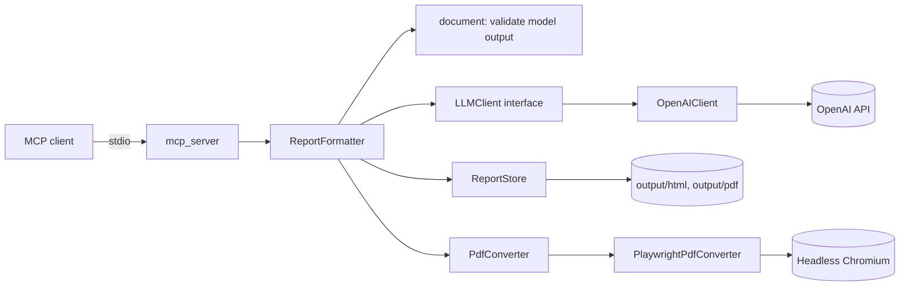

# Architecture

> **Status:** Early. Only the MCP server and LLM layer exist so far. Keep it current:
> a PR that changes how components connect updates this file.

## Overview

An MCP client calls a tool on the stock-analysis MCP server over stdio. The tool delegates to a
core module, which talks to an external service through an interface. Today the only tool is
`format_report`, which formats report content using OpenAI.

## System diagram

## Components

<!-- For each component: responsibility, location in the repo, and what it depends on. -->

| Component | Location | Responsibility |
|---|---|---|
| MCP server | `src/stock_analysis/mcp_server/` | Exposes tools over MCP; delegates to core modules |
| Reporting | `src/stock_analysis/reporting/` | `ReportFormatter`: builds the prompt (content, title, instructions, chart references), validates the model's HTML document, converts to PDF, warns on page overflow, saves files. The system prompt is `prompts/format_report.txt`. `PdfConverter` interface with a Playwright implementation. `ReportStore` writes the output files |
| LLM layer | `src/stock_analysis/llm/` | `LLMClient` interface and `OpenAIClient` implementation |
| Config | `src/stock_analysis/config.py` | Loads and validates env-var settings |

## Data flow

`format_report(content, ...)`: the client sends a tool call; the server invokes
`ReportFormatter.format_report`, which validates input, builds the prompt, and calls
`LLMClient.complete`. The model returns one complete HTML document with its own CSS, including one empty
`chart-slot` per chart reference; the formatter validates it, then calls
`PdfConverter.html_to_pdf`, then `ReportStore.save` (HTML and PDF
to separate directories). `OpenAIClient` calls the Responses API and returns the text; failures raise `LLMError`, which
MCP reports to the client as a tool error.

## External services

<!-- Every third-party API: what it's used for, the env var for its key, rate limits, and the
     ToS notes that matter. -->

| Service | Purpose | Config | Notes |
|---|---|---|---|
| Chromium (Playwright) | HTML to PDF rendering | `uv run playwright install chromium`; `HTML_OUTPUT_DIR`, `PDF_OUTPUT_DIR` | Local browser; JS and network disabled while rendering |
| OpenAI | LLM completions (`format_report`) | `OPENAI_API_KEY`, `OPENAI_MODEL` | Usage is billed per token |

## Key decisions

See [Architecture Decision Records](adr/).
